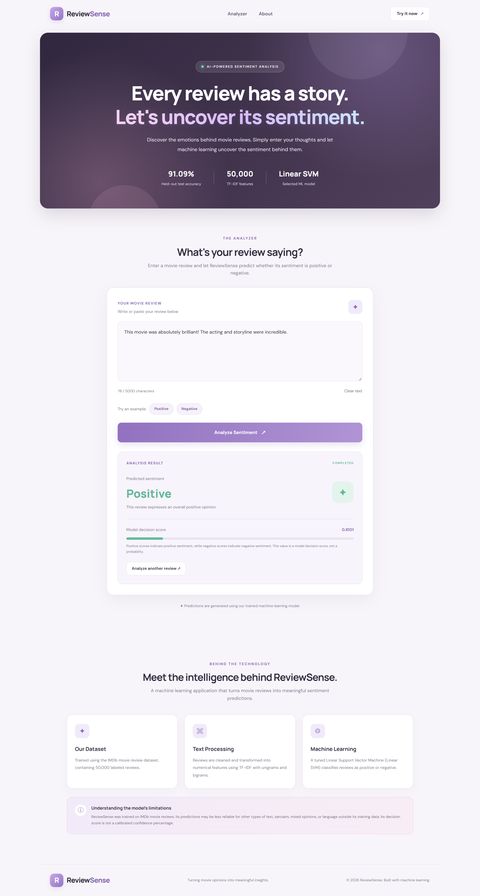
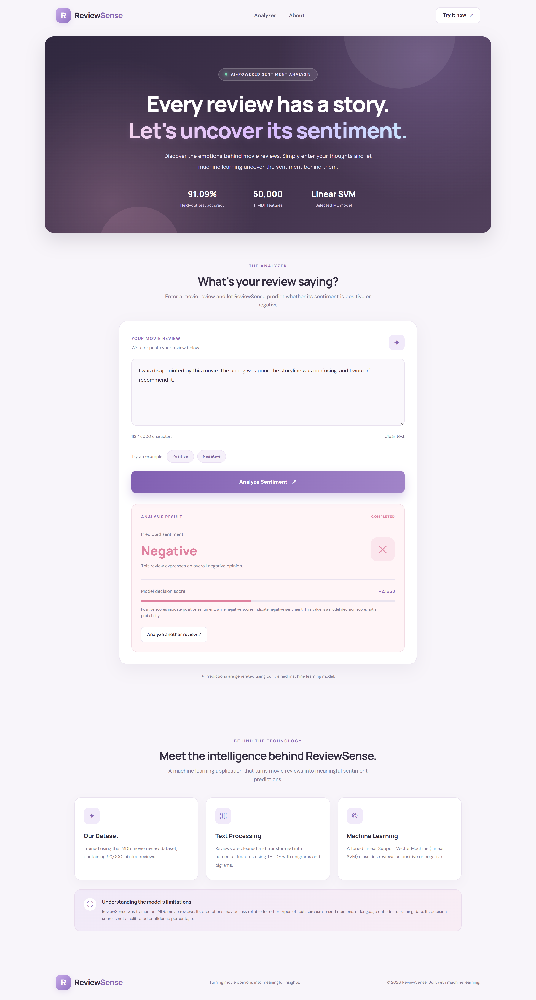
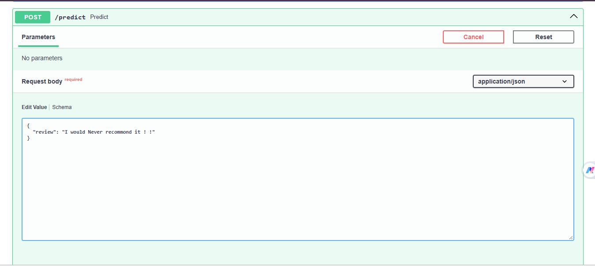
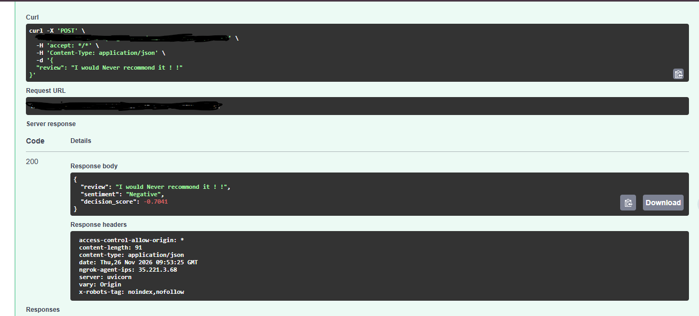

# 🎬 ReviewSense
### Movie Review Sentiment Analysis Using Machine Learning

ReviewSense is an end-to-end machine learning application that analyzes movie reviews and classifies them as **Positive** or **Negative**.

Built using Python, Scikit-learn, FastAPI, and a simple web frontend, the project demonstrates the complete journey from raw text data and model development to API integration and an interactive application.

---

## ✨ Application Preview

ReviewSense provides a simple interface where users can submit a movie review and receive an instant sentiment prediction.

### Positive Prediction


### Negative Prediction


### Backend API




---

## 🚀 Key Features

- Movie review sentiment classification.
- Text cleaning and preprocessing.
- TF-IDF feature extraction using unigrams and bigrams.
- Comparison of multiple machine learning algorithms.
- Hyperparameter tuning for model selection.
- FastAPI backend for real-time predictions.
- Interactive web interface connected to the prediction API.

---

## 🧠 Machine Learning Workflow

The project was developed through the following stages:

1. **Data Exploration:** Explored the IMDb movie review dataset, examined sentiment distribution, and investigated duplicate records.

2. **Data Cleaning:** Removed 418 duplicate records, resulting in 49,582 unique reviews.

3. **Text Preprocessing:** Removed HTML tags, converted text to lowercase, cleaned punctuation, and applied custom stopword removal while preserving important negation words.

4. **Feature Extraction:** Converted textual reviews into numerical features using TF-IDF with unigrams and bigrams.

5. **Model Training:** Trained and compared Logistic Regression, Multinomial Naive Bayes, and Linear Support Vector Machine (SVM).

6. **Model Optimization:** Evaluated model performance and tuned the Linear SVM hyperparameter.

7. **Model Evaluation:** Evaluated the selected model on an independent held-out test set.

8. **Application Development:** Saved the trained model artifacts, developed a FastAPI prediction endpoint, and connected it to a web-based frontend.

---

## 📊 Model Performance

The final model is a tuned **Linear SVM (C = 0.5)**.

| Evaluation Metric | Result |
|---|---:|
| Test Accuracy | **91.09%** |
| Precision (Weighted) | 0.91 |
| Recall (Weighted) | 0.91 |
| F1-Score (Weighted) | 0.91 |
| Cross-Validation Macro F1 | 0.902 |

### Test Confusion Matrix

| Actual / Predicted | Negative | Positive |
|---|---:|---:|
| Negative | 3,317 | 388 |
| Positive | 275 | 3,458 |

The model achieved 91.09% accuracy on the held-out test set.

---

## 🛠️ Technology Stack

| Area | Technologies |
|---|---|
| Programming Language | Python |
| Data Processing | Pandas, NumPy |
| Machine Learning | Scikit-learn |
| Text Processing | Regular Expressions, TF-IDF |
| Model Persistence | Joblib |
| Backend | FastAPI, Uvicorn |
| Frontend | HTML, CSS, JavaScript |
| Development Environment | Google Colab, VS Code |

---

## 🏗️ Project Structure

```text
ReviewSense/
│
├── backend/
│   ├── app.py
│   ├── requirements.txt
│   └── models/
│       ├── ReviewSense_SVM_Model.pkl
│       ├── ReviewSense_TFIDF_Vectorizer.pkl
│       └── ReviewSense_Stopwords.pkl
│
├── frontend/
│   ├── index.html
│   ├── style.css
│   └── script.js
│
├── notebooks/
│   ├── 01_ReviewSense_Training_Clean.ipynb
│   └── 02_ReviewSense_API_Deployment_Clean.ipynb
│
├── screenshots/
│
├── .gitignore
└── README.md
```

---

## ⚙️ Running the Project Locally

### 1. Clone the repository

```bash
git clone YOUR_GITHUB_REPOSITORY_URL
cd ReviewSense
```

### 2. Install backend dependencies

```bash
pip install -r backend/requirements.txt
```

### 3. Start the FastAPI server

```bash
cd backend
uvicorn app:app --reload
```

The API will be available at:

`http://127.0.0.1:8000`

Interactive API documentation:

`http://127.0.0.1:8000/docs`

### 4. Run the frontend

Open the `frontend` folder in VS Code and launch `index.html` using Live Server.

Make sure the API URL in `script.js` points to your local backend:

`http://127.0.0.1:8000/predict`

---

## ⚠️ Limitations

- The model is trained on IMDb movie reviews and is primarily intended for movie-review sentiment analysis.
- It may not reliably interpret sarcasm, complex slang, emojis, or informal expressions.
- Its performance on unrelated text or data from different sources may vary.
- The SVM decision score is a decision-function value, not a calibrated probability or confidence percentage.

---

## 🔮 Future Improvements

- Improve handling of slang, emojis, and sarcasm.
- Explore more diverse review datasets.
- Experiment with advanced NLP and deep learning approaches.
- Improve deployment and application accessibility.

---

## 📚 Dataset

The project uses the IMDb 50K Movie Reviews dataset, containing 50,000 movie reviews labeled as positive or negative.

The dataset was used for exploration, preprocessing, model training, validation, and testing. The raw dataset is not included in this repository.

---

## 👩‍💻 About the Project

ReviewSense was developed as a practical learning project during my AI Engineering journey.

Beyond building a sentiment classifier, this project helped me explore the complete machine learning application development process: from data preparation and model evaluation to backend development, API integration, frontend interaction, and debugging.

**The goal was to move beyond training a model and build an application around it.**

---

*Built with Python, Machine Learning, and curiosity. 💜*